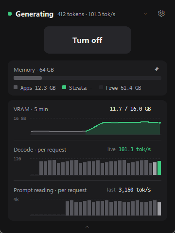

# Agent Start

A small Windows 11 widget that turns a local [Strata](https://github.com/Niko1221/Strata) LLM endpoint on and off,
and makes sure it gets the RAM it needs to run at full speed.



- **Turn on**: shows which RAM-hungry apps and games to close (games pre-ticked, nothing is closed without your OK)
  and whether that frees enough memory for Strata's full-RAM mode, then starts Strata from your `run-*.bat` and
  shows the load progress until the model is ready.
- **While serving**: what the model is doing right now (*Reading* a prompt with a progress bar, *Generating* with
  tokens and tok/s, *Queued*), plus optional VRAM / decode / prompt-reading graphs you can pin.
- **Turn off**: unloads the model, stops only Strata's own processes, checks the port is free, shows a toast, and
  reopens the apps it closed (games as a one-click *Reopen*).
- Notices a Strata you started yourself and adopts it. Warns when Strata fell back to its slower Low-RAM (SSD) mode.
- Lives in the system tray (X hides the window; the tray icon's dot shows the state, right-click for Turn on/off,
  Switch model and Quit), can start with Windows, finds your Strata folder on first start, tells you when a game
  starts while Strata holds the RAM and offers to turn Strata back on when it closes, keeps a local usage history,
  and offers new versions from GitHub with one-click install.

It can also run llama.cpp's `llama-server` instead of Strata (first version, see [Engines](#engines)).

Requires Windows 10/11 x64 and a Strata install (or llama.cpp's `llama-server`). Not affiliated with the Strata
or llama.cpp projects.

## Install

Download `AgentStart-Setup-<version>.exe` from [Releases](../../releases) and run it. It installs for your user
only (no admin prompt) to `%LOCALAPPDATA%\Programs\Agent Start`, with a Start-menu shortcut (desktop shortcut
optional) and an uninstaller. The exe is unsigned, so Windows SmartScreen may ask once: *More info → Run anyway*.

**First start:** the app looks for Strata in Downloads, Desktop, Documents, your home folder and the top levels of
your drives (a few seconds, read-only: folders with `serve\server.py` and a working `run-*.bat`). If it finds one,
the idle line says *Strata found · click to set up*, which opens Settings with that folder's launchers. Otherwise
(or to change it later) open Settings (gear) and pick your Strata `run-*.bat` (*Browse…* for any `.bat`). The app
reads the `.bat` and starts the same command itself; it never runs it.

**Tray:** closing the window (X) keeps the app running in the system tray; the icon's dot has the status colour.
Click the icon to open the window; right-click for *Turn on / Turn off*, **Switch model** (two or more `run-*.bat`)
and **Quit**. Windows 11 puts new tray icons in the hidden-icons (^) area: drag it onto the taskbar to keep it visible.
Turn the tray off in Settings and X quits as before.

**Start with Windows** (Settings, installed app only): starts hidden in the tray at logon (minimised to the taskbar
if the tray is off). It is a normal per-user startup entry: Task Manager → Startup apps shows it, and the uninstaller
removes it.

**When a game starts** (Settings; default *Turn Strata off*): while Strata serves, starting a game from your game
folders (Steam, Epic, Riot, Xbox, GOG, Battle.net) turns Strata off the safe way: a running reply or an agent's tool
call finishes first, no dialog appears over the game, and the apps closed for Strata wait as a one-click Reopen
instead of starting over it. A toast then says *ELDEN RING started · freed 49 GB for it*. A game started while
Strata is still loading cancels the load. *Ask me* shows a toast with a **Turn off Strata** button instead (it also
works from the notification centre after you alt-tab, for 30 min, for that Strata session only); *Do nothing* turns
it off. Launchers, SteamVR and redistributable installers don't count. Windows holds toasts back during full-screen
games (Do Not Disturb), which is why the default acts instead of asking.

**When memory runs low** (Settings; default *Ask me*): games are found by their install folder, so a game
installed elsewhere, or any other heavy program, is not noticed by the rule above. A second check watches two
things. The firm one: Strata's own memory in RAM has fallen below half of its peak for 6 seconds, that memory
did not come back as available memory (so Windows paged the model out; an unload gives it back), and an app
started after Strata became ready is running. This fires after the model has been pushed out - on a 64 GB PC a
game did that to a 49 GB model within about 10 seconds - so it rescues the PC and the app, not the loaded model.
The softer one: such a new app holds a lot of memory (4 GB for the whole app by default) while the PC runs
short of available memory for 15 seconds. *Ask me* shows a toast naming the
app and its memory, with the same **Turn off Strata** button; *Turn Strata off* does the same safe turn-off as
for a game; *Do nothing* switches the check off. It only observes: it never closes anything. Apps on your
protected list, system processes and apps that were already open never trigger it, and an app is reported
once per Strata session. The thresholds are `mem_watch_*` keys in `config.json`.

**When that app closes** (Settings; default *Ask me*): when Agent Start itself turned Strata off for a game or
for a memory-hungry app (the two rules above), it watches for that game or app to close. It counts as closed once
it has been gone for about 10 seconds, so a game that restarts through its launcher does not count; the watch gives
up after 6 hours. *Ask me* shows a toast *ELDEN RING closed* with a **Turn on Strata** button (it works for 30 min).
*Turn Strata back on* starts Strata by itself, without the start dialog: nothing is closed, so Strata may load in
Low-RAM mode if other apps hold the memory. It asks instead (as *Ask me* does) when the same game or app already
got an automatic turn-on in the last 30 minutes, so a game that keeps restarting cannot load and unload the model
in a loop, and when a *Reopen* offer is still waiting, because a start would discard it. *Do nothing* switches it
off. Turning Strata on yourself ends the watch. A game that cancelled a Strata that was still loading is watched
the same way. It only observes: it never closes anything. The timings are `resume_*` keys in `config.json`.

**Updates:** once a day the app asks GitHub for the latest release (one small request, no data about you). When a
newer version exists, the idle line says *Update to x.y.z available · click to install*. Click → confirm → it
downloads the installer from this repo's Releases, checks its size and SHA-256 against what GitHub lists, closes,
upgrades silently and starts again. A running Strata keeps running. Nothing is downloaded without your click.

Settings and logs live in `%APPDATA%\AgentStart` (`config.json`, `logs\`, `state.json`, `usage.json`); the first launch copies
the bundled default config there. Uninstalling keeps that folder. Upgrading from the earlier name *Hermes
Controller* replaces it and moves its settings over.

From source instead: `python -m venv .venv`, `.venv\Scripts\pip install -r requirements.txt`, then `run.bat` (or
`.venv\Scripts\python.exe main.py` with a console). Config and logs then stay in the project folder. Only one
instance can run either way.

## Build

```bat
build.bat
```
version files → icon → PyInstaller one-folder `dist\AgentStart\` → Inno Setup installer
`dist\AgentStart-Setup-<version>.exe`.
Needs the project `.venv` (`pip install -r requirements.txt`) and Inno Setup 6 (`winget install JRSoftware.InnoSetup`).
The installer bundles `config.default.json` (no machine-specific paths) as the default config.

**Version**: `version.py` is the only place to bump. `build.bat` first runs `tools\sync_version.py`, which
regenerates `installer\version_info.txt` (exe properties) and `installer\version.iss` (included by the Inno
script); the Settings dialog and the log show the same number.

## The window

| Area | Shows |
|---|---|
| Status line | LED + state + a short summary: Idle (grey) *2 apps to close · 6.8 GB* · Starting (amber) *Loading experts into RAM* + timer · Serving (green) *model* · Low-RAM (amber) · Error (red) *what failed*. While Strata works on a request it shows the model state, like Strata's Monitor: **Reading** (blue) *12% · 10,752 / 87,072* with a thin progress bar under the line, **Generating** (green) *412 tokens · 98.4 tok/s*, **Queued** (amber) *2 waiting*; then back to Serving. Read from `/metrics` once a second while serving (paused while minimised). Click it to show or hide the detail line (remembered) |
| ⇄ (left of ⚙) | **Switch model**: shown when your Strata folder has two or more `run-*.bat`. Pick one: while idle it becomes the launcher for the next Turn on; while serving, Strata stops and starts again with the new model (the apps closed for the old one stay closed). Disabled while starting/stopping |
| ⚙ | **Settings**: Strata launcher, the Strata dashboard link + API address, Protected apps, Usage history, *Reopen closed apps after Turn off* (see below). Disabled while starting/stopping |
| Detail line | Optional: idle = which apps would be closed; serving = *Up 12 min · last reply 85 tok/s*. Always shown when it matters: loading (phase, *usually 0:58*, progress bar), Low-RAM mode, errors (click opens the log), notes such as *Stopped · freed 47 GB*, and the one-click *Reopen …* offer |
| Button | **Turn on** · **Cancel** (while starting) · **Turn off** |
| Panels | **Memory** (bar + legend of physical RAM: other apps · Strata · free; "Freed" total for the session), **VRAM**, **Decode**, **Prompt reading** (see Stats). Each has a pin (shown on hover; filled when pinned): pinned panels stay visible while collapsed, in this order. Default: Memory pinned. Nothing pinned = just the status line and the button |
| ⌄ bar (bottom) | Shows / hides the panels that are not pinned; the window grows downward. Hidden when every panel is pinned. Pins and the open/closed state are remembered |

## Settings (⚙)

Settings has three tabs. **Model**: the engine and what it starts (Cancel / Save). **Behaviour**: what happens when
other apps need the PC, after Turn off, tray and Start with Windows. **About**: version and updates, usage history,
the endpoint. Everything on Behaviour and About applies at once.

- **Engine** — *Strata* or *llama.cpp* (see [Engines](#engines)). Choosing another engine asks once, then
  Agent Start restarts into it. If the current engine is running it is turned off first (the normal Turn off,
  which asks while a reply runs); say no there and nothing changes.
- **Strata launcher** (with llama.cpp: a program box and an arguments box, see [Engines](#engines)) — a dropdown
  of every `run-*.bat` in the Strata folder (other `.bat` files such as
  `SETUP.bat` are not listed) plus **Browse…** for a `.bat` anywhere. The line below shows what that launcher
  runs: *model · config file · port*.
  The app only **reads** the `.bat` — it never runs it. It takes the line that starts
  `python … serve\server.py …` (honouring `cd /d`, `set VAR=`, `%~dp0`, `^` continuations), drops `--open` (no
  browser tab) and starts that command itself, so the log, the progress bar and OFF keep working. A `.bat` that
  does not start `serve\server.py`, or whose python/config file is missing, is rejected with the reason shown
  in the dialog.
  **Save** writes the choice to `config.json`. If Strata is running, nothing is restarted: the main window shows
  *"run-….bat applies next start"* and the new launcher is used the next time you turn it on.
- **Context length** and **Vision** (Strata) — under the launcher, when its run config (`strata-<model>.json`) has
  them: 32K / 64K / 128K / 256K tokens (plus the launcher's own value), and On / Off for reading pictures. Vision
  is only offered for a model Strata set up with vision. Strata's own files are never edited: the choice is kept in
  Agent Start's `config.json` (`strata_tuning`), and at each Turn on a copy of the run config with only those two
  options changed is written to `%APPDATA%\AgentStart\strata\` and handed to Strata. Pick the launcher's own
  values again and Strata gets its own file. Tested with Strata 0.2.10 on one PC. The RAM check before Turn on
  still assumes the launcher's own context.
- **Endpoint** — **Open Strata dashboard** opens Strata's own web app (`http://127.0.0.1:<port>/`: chat, Monitor,
  its settings) in your browser; greyed out with *not running* while Strata is off. Below it the API address
  (`…/v1`) with **Copy**, for pasting into Hermes or other clients.
- **Protected apps…** — the whitelist: apps that are never offered for closing.
- **Usage history…** — a window with totals for 7 days, 30 days or all (requests, generated tokens, average tok/s,
  time served), a bar per day of generated tokens, and a table per day and per model (requests, prompt tokens,
  generated tokens, average speed, time served). It is kept in `usage.json` in the data folder, on this PC only;
  nothing is sent anywhere. History starts with the first request after 1.10 is installed, and days older than 400
  days are dropped. The average speed is weighted by tokens and leaves out very short answers. Prompt tokens are
  the tokens Strata actually read: the part of a prompt it still had cached (an agent re-sends its whole context
  every turn) is not counted again.
- **Switches** (apply at once): *Reopen closed apps after Turn off* (same as the start dialog's checkbox; off = the
  closed apps are offered as one click instead), *Keep running in the tray*, *Start with Windows*, *When a game
  starts*, *When memory runs low*, *When that app closes*, *Check for updates daily*.
- **Check for updates** (About tab) — asks GitHub now, whatever the daily switch says, and
  shows the answer next to the button: up to date, a new version (the version label becomes the install link),
  or that GitHub could not be reached. It only checks; installing still asks first. Greyed out when the app
  runs from source.

## Engines

Agent Start runs one model server, the engine. There are two:

- **Strata** (default): everything described above.
- **llama.cpp** (new, first version): llama.cpp's `llama-server.exe` serving one model.

To use llama.cpp:

1. Settings (⚙) → **Engine** → *llama.cpp*, and confirm. Agent Start restarts into llama.cpp.
2. It then looks for llama.cpp and for model files on this PC (a few seconds, read-only):
   - builds: the winget package, folders on `PATH`, and `llama-server.exe` next to `llama.dll` / `ggml.dll` in
     Downloads, Desktop, Documents, your home folder and near drive roots;
   - models: `.gguf` files of 100 MB or more in those places, llama.cpp's own cache, the Hugging Face cache and LM
     Studio's models folder (vision projectors and later parts of split files are left out).
   With one model found it sets itself up (`-m <model> --port 9931`, the best build) and says so; nothing is
   started. With several models the window shows a card with what was found, and the main button reads
   **Choose model**: it lists the models, and picking one finishes the set-up. After that the ⇄ button next to
   the gear switches between the found models (only the model in the arguments changes; a running model is
   turned off first, the same way as a Strata model switch).
3. Settings (Model tab) shows **Build**, **Model**, **Context length**, **Vision** and **Port**. On an NVIDIA
   card the CUDA build comes first. Each control rewrites one option in the arguments and keeps the rest:
   - *Context length*: Auto (the model's own), 8K to 128K; a value typed by hand shows as custom. While nothing is
     serving, a note under it says whether that choice fully fits the GPU (the same check as at Turn on).
   - *Vision*: Off, or a vision file (`mmproj-*.gguf`) found in the model's folder. Not yet tried with a real
     model start.
   - *Port*: the `--port` value.

   The program box and the arguments box are under **Advanced · program and arguments**, which opens by itself
   when the arguments cannot be shown by the controls. You can *Browse…* for `llama-server.exe` and type the
   arguments yourself, e.g. `-m C:\models\model.gguf --port 9931`.
   - An explicit `--port N` is required (with a space; `--port=N` is refused). llama-server's own default port is
     9931; Agent Start does not rely on it.
   - A model is required: `-m <file.gguf>` or `-hf <user>/<model>`. Router mode (no model) is not supported, and
     neither is `llama.exe serve`.
   - `--host` must include 127.0.0.1 (or leave it out); `--api-prefix` is refused.
   - Save takes the port and the API address from `--port`, and the first `--api-key` (as `api_key`).

| With llama.cpp | |
|---|---|
| Turn on | Starts `llama-server.exe` with your arguments; the load shows phase labels (*Loading model weights*, *Setting up the context*), no percentage |
| A server you started yourself | Adopted when it runs on the configured port (recognised by its `Server: llama.cpp` reply header) |
| Status line | *Reading* / *Generating* / idle, from the server's `/slots` |
| Speed graphs, usage history | From the server's log, for a server Agent Start started (an adopted one is not recorded) |
| Safe Turn off | A normal Turn off asks first while a reply runs (`/slots`). Tool calls are not visible, so *Turn off when it's done* waits for 60 s of idle instead |
| Turn off | Ends `llama-server.exe` and its console host (and `llama-connect.exe` from the same folder, if `--connect` started one); nothing else |
| App sweep | Never offers `llama-server.exe` or anything in its folder for closing |
| Dashboard link | *Open llama.cpp dashboard* opens llama-server's own web page on `/` (not with `--no-ui`) |
| Not available | Unloading without ending the process, a load percentage, tool-call awareness, the full-RAM / low-RAM plan |

Tested on one PC with llama.cpp build b12314 (the winget build and the CUDA build from llama.cpp's GitHub
releases). Not tested yet: setups with `--api-key`, other builds.

**Speed:** llama.cpp builds differ. The winget package is a Vulkan build; on an NVIDIA card the CUDA build from
llama.cpp's GitHub releases was about twice as fast in one test. A model that does not fully fit in video memory
runs partly on the CPU and is much slower.

**GPU-fit warning:** Agent Start tells you when that happens, with an amber line in the window (no notification):

- *At Turn on* it asks llama.cpp's own `llama-fit-params.exe` (from the same folder as your `llama-server.exe`,
  with your model and context size) whether everything fits. The tool only reads the model file and the card; it
  answers in a second or two, and the server is started right after (at most 6 seconds later, answer or not). If two or more layers would stay off the card,
  the window says *Won't fully fit on the GPU · will run partly on the CPU (slower)*. There is no check when the
  tool is missing, when you set `-ngl` yourself, with `--fit off`, or for a model that would be downloaded, and
  its answer is dropped when Turn on finds a server already running.
- *While a reply is generating* it watches for the symptom: video memory at 90% or more and the server using 25%
  or more of all CPU cores, for 8 seconds. Then the window says *Running partly on the CPU (slower) · a smaller
  context or model would fit the GPU*. 20 seconds of generating without the symptom clears the line, including
  one the first check raised. This check needs a video-memory reading (NVIDIA cards).

The four limits are `fit_watch_*` in `config.json`. They were set from a few runs of one 27B model on one 16 GB
card, so treat them as a starting point. Strata is not checked: it manages its own memory plan.

**Switching back and forth:** each engine keeps its own launch settings (program or launcher, port, model) in
`config.json` under `engine_profiles`, so switching back restores them. A `config.json` from 1.11.0 that still
has the other engine's command is sorted out at the next start. An engine that was never set up looks for its
install after the switch: Strata sets itself up when it finds one install with one `run-*.bat`, otherwise it
offers what it found as before.

How the engines plug in: `docs/engines.md`; the llama.cpp module: `docs/llama_server_design.md`.

## Stats section

Three compact graphs (drawn by the app itself, no extra libraries). Whether the section is open is remembered.

| Graph | Shows |
|---|---|
| VRAM · 5 min | GPU memory used vs total over the last 5 minutes (whole card, sampled every 2 s via NVIDIA NVML). The stretch where Strata was running is green, the rest grey. "VRAM unavailable" without an NVIDIA driver |
| Decode · per request | Generation speed (tok/s) of the last 30 finished requests, newest right. While a reply is being generated its live speed is the green bar and the value marked *live*; otherwise the value is the *last* request |
| Prompt reading · per request | Prompt-reading speed (tokens read ÷ reading time) of the last 30 requests; live while a prompt is being read. Requests answered from the prompt cache (fewer than 64 tokens read) are left out so they do not distort the scale |

The two speed graphs come from Strata's own `GET /metrics`, polled every 2 s **only** while Strata is serving and
the section is open; the label on the left of each graph is its scale maximum. Strata reports just its 12 newest
requests per poll, so the bars build up while the section is open; they stay after OFF and reset at the next ON.

## Closing apps (the sweep)

Nothing is closed automatically. Pressing **ON** opens a list of candidates; **games are pre-ticked**, plus
whatever the full-speed RAM check below adds. Choose *Close selected & start*, *Start without closing*, or *Cancel*. Closing sends the window a normal close
first, waits up to 3 s, then force-closes what is left — **unsaved work in those apps is lost**.

Candidates are apps that are not protected and match one of:

| Category | Rule | Pre-ticked |
|---|---|---|
| game | exe under `steamapps`, `Epic Games`, `Riot Games`, `XboxGames`, `GOG Galaxy`, `Battle.net` and ≥ 50 MB | yes |
| gpu | > 200 MB dedicated VRAM (Windows GPU counters) | no |
| window | has a real visible window and > 250 MB RAM | no |
| background | no window, > 1 GB RAM (tray apps) | no |

Never offered (built in, cannot be unticked): Windows/system processes and anything under `C:\Windows`,
terminals/shells/IDEs, `python`/`node`/`claude`/`hermes`, Strata itself, FanControl, LibreHardwareMonitor,
Tailscale, this app and the program that launched it. Your editable whitelist (`config.json` →
`user_whitelist`, default: common browsers, Discord, terminals, VS Code, Obsidian, FanControl, OpenRGB,
NVIDIA App/Overlay; edit it under Settings → Protected apps) protects those apps and everything they started.

### Full-speed RAM check

Strata is fast only when its whole **expert arena** fits in RAM (46.84 GiB for swift-iq3_s, 39.97 GiB for
swift-iq3_xxs). With less available it waits 20 s, then falls back to **Low-RAM mode**: experts are read from the
SSD and decode drops from ~90–100 to ~15–20 tok/s. The arena size is learned from Strata's engine log (the `"log"`
file named in the launcher's `--config` JSON), so the check works per model and only after that model has loaded
once.

- **Start dialog:** "Full speed needs ~50 GB free · you have 40 GB". If closing apps can close the gap, the fewest
  apps are pre-ticked (largest first; with similar sizes, background/GPU apps before ones with a window; protected
  apps never). A live line updates as you tick: *Ticked apps free ~X GB → full speed* or *Still ~Y GB short →
  Low-RAM mode (slower)*. If even closing everything is not enough, nothing extra is ticked and it says so.
- **While loading:** the engine log is read alongside the progress: *Waiting for RAM · needs 47 GB, 40 GB free*, then
  *Low-RAM mode · reading experts from SSD · slower* in amber if it falls back.
- **While serving:** the status reads **Serving · Low-RAM mode** with an amber LED and the shortfall, e.g.
  *Low-RAM mode: reading from SSD (slower) · ~7.3 GB short*. Turn off, close apps, turn on again for full speed.

Target = arena + 2.5 GiB headroom, measured against Windows *available* RAM (calibrated on real launches: ~49.6 GiB
after a sweep still reached full RAM, after Strata waited ~13 s for the freed memory). Freed RAM per app is its working set,
so the numbers are estimates (shown with "~"). Code: `engine_log.py`, `ram_plan.py`.

### Reopening closed apps

The start dialog has **Reopen these when Strata stops** (ticked by default, remembered; also a switch in Settings). Before the sweep closes an
app it records how that app was started (program, arguments, folder; Store apps by their app ID). After **Turn off**
releases the memory, those apps are started again one at a time, a second apart: *Reopening apps 1/3 · Spotify
started*, then *Reopened 3 apps*.

- **Games are not restarted automatically** (launchers and anti-cheat expect to be started their own way). They stay
  as a one-click **Reopen eldenring** line on the idle screen; it clears when you turn Strata on again.
- **Skipped:** apps that ran as administrator, programs that no longer exist, Windows programs, and background Store
  apps that Windows restarts itself. Apps you already reopened by hand are not started twice.
- If Strata stopped some other way (crash, closed outside the app), the idle screen offers **Reopen N closed apps**.
- Apps restart fresh: unsaved work in them is still lost (browsers usually restore their tabs).
- Launching never goes through a shell: only the recorded `.exe` (checked to exist and to match the recorded command
  line) or `explorer.exe shell:AppsFolder\<app id>`. Code: `reopen.py`; records are captured in `detector.py`.

## Configuration (`config.json`)

| Key | Meaning |
|---|---|
| `launcher_bat` | Full path of the chosen launcher `.bat` — set by ⚙ Settings. (A v1.0 config with just a file name still works: it is looked up in `strata_dir`) |
| `launch_cmd`, `launch_cwd`, `strata_dir` | Derived from that `.bat` on Save: the command the app starts (without `--open`), the folder it starts it in, the Strata install folder |
| `endpoint_url`, `port`, `model_name` | Also derived: `http://127.0.0.1:<--port>/v1`, the port (8080 if the `.bat` has none), the model name from the launcher's `--config` json (else its file name) |
| `ready_timeout_s` / `stop_timeout_s` | 180 / 20 |
| `min_ram_mb`, `min_vram_mb`, `min_game_ram_mb` | 250 / 200 / 50 |
| `game_dirs`, `game_exclude` | Game folders; exe names never treated as games (Wallpaper Engine) |
| `user_whitelist` | Edited by the ⚙ dialog |
| `backend` | The inference engine: `strata` (default; a missing or unknown value means `strata`) or `llama_cpp`. Set by the Engine row in Settings. See [Engines](#engines) and `docs/engines.md` |
| `fit_watch_vram_pct`, `fit_watch_cpu_pct`, `fit_watch_sustain_s`, `fit_watch_clear_s` | llama.cpp only, the live GPU-fit check: video memory at least this full (90) and the server at least this share of all CPU cores (25) for this many seconds of generating (8) shows the warning; this many seconds without it (20) clears it |
| `engine_profiles` | Written by the app: the launch settings of the engine that is not in use (`launch_cmd`, `launch_cwd`, `launcher_bat`, `strata_dir`, `model_name`, `endpoint_url`, `port`, `api_key`), restored when you switch back |
| `strata_tuning` | Written by Settings: your Context length / Vision choice per Strata run config. Remove it and Strata gets its own file |
| `api_key` | llama.cpp only: the first `--api-key` from the arguments, saved by Settings; sent as a Bearer header only after the port identified itself as llama-server |
| `mem_watch_app_mb`, `mem_watch_sustain_s` | Memory-pressure check: an app's memory that counts as large (4096), and how long both conditions must hold (15) |
| `mem_watch_evict_pct`, `mem_watch_evict_sustain_s`, `mem_watch_evict_app_mb` | Pushed-out check: Strata's memory in RAM below this share of its peak (50) for this long (6), and the smallest new app that is named as the cause, in MB (512) |
| `mem_watch_floor_baseline_pct`, `mem_watch_floor_total_pct` | "Running short" = available memory below the smaller of this share of what was available when Strata became ready (50) and this share of installed RAM (6) |
| `resume_confirm_s`, `resume_expire_s` | When that app closes: how long the game or app must be gone before it counts as closed (10), and when the watch gives up (21600), in seconds |

To serve another Strata model, pick its `run-*.bat` in ⚙ Settings — no hand-editing needed. `state.json` (next to
`config.json`) remembers the last cold-load time and whether the stats section is open.

## Known limitations

- **Launchers count as games.** Epic Games Launcher, Riot Client and Battle.net live in game folders, so they are
  pre-ticked. Untick them or add them to the whitelist.
- **VRAM per app is an estimate.** NVIDIA's NVML reports nothing per process on Windows; the app uses Windows' GPU
  memory counters, capped at the card's real usage. *VRAM freed* after a sweep is measured on the whole card.
- **Stopping during a reply**: while Strata is reading or writing a reply, Turn off (and a model switch) asks first: *Turn off when it's done* waits until the model has been idle for 6 s (the toggle then reads *Stop now*, and the line under it says *Turns off after this reply · Cancel*; the toast then says it turned off after the reply), *Turn off now* cuts the reply off, *Keep running* does nothing. Agents (Hermes and others) answer in several requests: when a request ends with a tool call (web search, file read…), the app knows the agent will come back with the result and keeps waiting (*Agent running web_search*), for up to 10 minutes per tool. It turns off after a request that ends with an answer. Stopping Strata ends any
  chat session that is using it.
- **First scan** after launch takes ~2 s (later ~0.3 s); it runs in the background.
- **Launcher is parsed when you save it.** If you later edit that `.bat` (or Strata's updater rewrites it), open
  ⚙ Settings and press Save again to pick up the change.
- **Stats need Strata's monitor data.** If Strata is started with an API key, `/metrics` answers 401 and the speed
  graphs show "Metrics unavailable". VRAM is the whole card (all apps), NVIDIA only.
- **Only run-\*.bat launchers that call `python … serve\server.py` directly** are understood; a `.bat` that
  delegates to another script is rejected.
- Windows only.

## Tests

Each `tests\test_*.py` is a standalone script: run it from this folder with the project venv, it prints `[PASS]` /
`[FAIL]` lines and a summary, and exits 0 when everything passed. There is no pytest.

```bat
.venv\Scripts\python.exe tests\test_stats.py
.venv\Scripts\python.exe tools\run_tests.py --list
.venv\Scripts\python.exe tools\run_tests.py --ci
.venv\Scripts\python.exe tools\run_tests.py test_ui_smoke test_tray
```
`tools\run_tests.py` runs suites one after another and prints a summary table: `--list` shows every suite and
whether CI runs it, `--ci` runs the headless suites with the same switches as CI, or name the suites you want.

Lint and type check (dev tools: `pip install -r requirements-dev.txt`; config in `pyproject.toml`):
`.venv\Scripts\python.exe -m ruff check .` and `.venv\Scripts\python.exe -m mypy`.

**CI** (`.github/workflows/ci.yml`, Windows runner, Python 3.11 and 3.14): ruff, mypy, then the suites marked *CI*
below. *Advisory* suites run too, but a failure there does not fail the build (no GPU, timing limits, no guaranteed
notification area on a runner). *Local* suites open the real window and take screenshots, so they need a desktop.

| Script | CI | What it covers |
|---|---|---|
| `tests\test_config_store.py` | CI | The one-time move of the pre-v1.5 data folder ("Hermes Controller") to the new name |
| `tests\test_identity.py` | CI | Strict Strata identity for the stop path (a process that merely *mentions* `serve\server.py` is never killed) |
| `tests\test_load_progress.py` | CI | Strata log → phase/progress (plus the newest log in `logs\`, when there is one) |
| `tests\test_launcher_bat.py` | CI | The `run-*.bat` parser: continuations, variables, relative paths, shims, rejections (+ your real `.bat` files with `STRATA_DIR`) |
| `tests\test_engine_log.py` | CI | Full-RAM vs low-RAM (SSD) detection from Strata's engine log: real-log fixtures + edge cases |
| `tests\test_ram_plan.py` | CI | Which apps to pre-tick so Strata reaches its full-RAM mode |
| `tests\test_stats.py` | CI | `/metrics` accumulation and speed maths, fetch against the fake Strata, VRAM sampler with and without NVML, version files in sync |
| `tests\test_reopen.py` | CI | Reopening closed apps: launch rules and refusals, against its own dummy processes only |
| `tests\test_game_watch.py` | CI | Game-launch detection: baseline, launchers, one alert per install, real throwaway "game" process |
| `tests\test_strata_finder.py` | CI | The Strata search: depth/time limits, decoys, skipped folders, junctions, hostile UNC paths |
| `tests\test_autostart.py` | CI | Start with Windows in a throwaway HKCU key: quoting, Task Manager's disabled flag, refresh |
| `tests\test_toasts.py` | CI | Toast titles/messages are data, never code (PowerShell only parses the XML back; no toast shown) |
| `tests\test_updater.py` | CI | GitHub release check + download against a local server: size/SHA-256, redirects, cancel, path checks, installer argv; a throwaway Inno Setup installer when ISCC is present |
| `tests\test_update_controller.py` | Local | The update flow as its own controller, with a stubbed updater and a fake app: daily check, the manual "Check for updates" (ignores the interval, one request at a time), offer, confirm, download, install hand-off; the Settings button states (one invisible window) |
| `tests\test_mem_watch.py` | CI | Memory-pressure trigger: the decision function on fake process lists (both conditions, sustain, once per session, protected and system apps, games already reported), config fallbacks, the shared scan |
| `tests\test_resume_watch.py` | CI | When that app closes: is the game/app still running (fake process lists), the confirm window, gaps and expiry, the watcher with a fake clock and on its own thread, one read-only real snapshot (starts no process) |
| `tests\test_kill_path.py` | CI | What a stop may kill and when it refuses, on fake processes: kill targets, the launcher cmd.exe, identity, foreign listeners, busy, force |
| `tests\test_engines.py` | CI | The engine interface: registry and `backend`, the Strata engine's answers, and a fake llama-server-shaped engine driving the supervisor (no unload, no launcher; an engine cannot widen a kill; API key never sent with the identity probe) |
| `tests\test_fit_check.py` | CI | The pre-check runner: only `llama-fit-params.exe` next to the engine program is ever run, windowless, time-limited |
| `tests\test_fit_watch.py` | CI | The live GPU-fit rule (pure): sustain and clear windows, gaps, missing figures |
| `tests\test_gpu_fit_ui.py` | Local | The GPU-fit warning in the app window (opens one window), fakes only |
| `tests\test_llama_finder.py` | CI | The search for llama.cpp builds and model files, on made-up folders: what counts, what is skipped, ranking, limits |
| `tests\test_engine_profiles.py` | CI | Per-engine launch settings: parked on a switch, restored on the way back, a 1.11.0 config sorted out |
| `tests\test_engine_switch.py` | Local | Engine switch in the app window: the question, Turn off first, saved only then, restart (opens windows) |
| `tests\test_review_fixes.py` | Local | Fixes from the v1.12 review: memory-watch arming, engine switch during a pending turn off, apps left by an interrupted reopen, sweep-dialog clicks (opens windows) |
| `tests\test_engine_find.py` | Local | After a switch: automatic set-up with one clear choice, else Build / Model dropdowns (opens windows) |
| `tests\test_llama_cpp.py` | CI | The llama.cpp engine on fakes only (nothing started or contacted): identity, launch checks and Save, `/health` and `/slots`, log parsing, load phases, the GPU-fit pre-check arguments, and stop/adopt through the real supervisor |
| `tests\test_metrics_sample.py` | CI | Engine-neutral metrics samples: the Strata converter, old-vs-new store equivalence, a non-Strata sample, the Strata poller with fake fetchers |
| `tests\test_usage_history.py` | CI | Usage history store: per-day / per-model totals, local midnight, each request counted once (also across an app restart), token-weighted speed, time served, atomic writes, corrupt or unreadable `usage.json`, dropping old days, threads; temp files only |
| `tests\test_server_manager.py` | CI | Fake Strata on a random port: start/ready/timeout/lazy-load/adopt/busy+force/cancel/foreign-listener/launcher topology/launch from a parsed `.bat` (shows one real toast) |
| `tests\test_detector.py` | Advisory | Real-system scan + dry run (asserts nothing protected is ever listed), synthetic graph rules, kill test on its own throwaway process only |
| `tests\test_tray.py` | Advisory | Tray icon on its own thread: status icon, menu + Switch model submenu, balloon clicks, callbacks, no GDI leaks (shows one balloon) |
| `tests\test_ui_smoke.py` | Local | UI with stub backends, every state, Settings dialog, stats section (100 % and 150 % scaling), screenshots `tests\ui_*.png` |
| `tests\test_busy_switch.py` | Local | Safe Turn off during a reply (busy dialog / stop when idle) and the quick model switch, stub backends, screenshots `tests\ui_busy_*.png` |
| `tests\test_history_dialog.py` | Local | The Usage history window (opens one window) |
| `tests\test_e2e_fake.py` | Local | The real app + real manager/detector/NVML against a fake Strata started from a parsed `.bat`: ON → graphs fill → change launcher → OFF → ON |
| `tests\test_app_extras.py` | Local | Tool-call-aware safe Turn off, tray wiring, update offer/install flow (stubbed), first-start Strata search, the reopen switch |
| `tests\test_v110.py` | Local | The 1.10 additions in the app window: When that app closes, Usage history, the Engine row |
| `tests\run_real_idle.py` | Never | **Real** backends: the real app against your real setup, IDLE only, no clicks, no kills, screenshot |
| `tests\run_real_onoff.py` | Never | **Real** Strata ON → OFF through the app (only with explicit intent; closes no apps) |
| `tests\run_installed_onoff.py` | Never | **Real** Strata through the **installed** `AgentStart.exe`, driven with mouse clicks (only with explicit intent) |

None of the `test_*.py` suites touch the real Strata, port 8080, or any app they did not start; fake servers use free
random ports. The `run_*.py` scripts do use the real Strata and are never run by CI or `tools\run_tests.py`.

Environment switches:

| Variable | Effect |
|---|---|
| `AGENTSTART_TEST_OFFLINE=1` | `test_updater` skips its one read-only request to api.github.com (set in CI) |
| `AGENTSTART_TEST_NO_INNO=1` | `test_updater` skips compiling and running its throwaway Inno Setup installer (set in CI) |
| `STRATA_DIR=<your Strata folder>` | Optional: `test_launcher_bat`, `test_strata_finder` and `test_engine_log` also check your real install (read only). Unset in CI |

Design and contracts: `SPEC.md` (v1 and the advisor review history in `docs\`).

## License

MIT, see [LICENSE](LICENSE).
